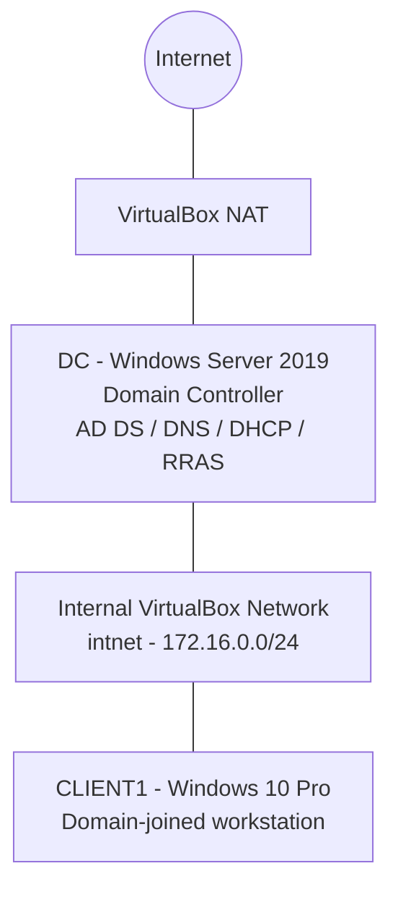

# Active Directory Home Lab

A hands-on Windows Server and Active Directory home lab built with Oracle VirtualBox and PowerShell. The project simulates a small business network with a Windows Server 2019 domain controller, centralized directory services, DHCP, DNS, network routing, and a Windows 10 domain client.

The purpose of this project was to gain practical experience with Windows Server administration, Active Directory, network configuration, PowerShell, and domain authentication.

<details>
<summary>Project status</summary>

**Core lab implementation completed.**

The domain controller, Active Directory environment, internal network, DHCP, NAT routing, Windows client, domain joining, and domain user authentication were configured and tested.

</details>

## Project Overview

The lab consists of two virtual machines:

- **DC:** Windows Server 2019 Standard Evaluation, configured as the domain controller.
- **CLIENT1:** Windows 10 Pro, configured as a domain-joined workstation.

The domain controller provides centralized authentication and network services to the internal lab network.

### Lab Architecture



The domain controller uses two network adapters:

- **INTERNET:** VirtualBox NAT adapter for external connectivity.
- **INTERNAL:** VirtualBox Internal Network adapter for communication with the lab client.

RRAS provides NAT routing between the internal network and the external connection.

## Technologies Used

| Technology | Purpose |
|---|---|
| Oracle VirtualBox | Virtual machine hosting and network configuration |
| Windows Server 2019 | Domain controller operating system |
| Windows 10 Pro | Domain-joined client operating system |
| Active Directory Domain Services | Centralized directory and domain authentication |
| DNS | Domain name resolution |
| DHCP | Automatic IP address assignment |
| Routing and Remote Access (RRAS) | Routing and NAT |
| PowerShell | Active Directory administration and bulk user creation |
| PowerShell ISE | Running and managing PowerShell scripts |

## Lab Configuration

### Domain Controller

| Setting | Configuration |
|---|---|
| Computer name | DC |
| Operating system | Windows Server 2019 Standard Evaluation |
| RAM | 2 GB |
| Processors | 4 |
| Virtual disk | 40 GB |
| Domain | mydomain.com |
| NetBIOS name | MYDOMAIN |
| Internal IP | 172.16.0.1 |
| External adapter | NAT |

### Windows Client

| Setting | Configuration |
|---|---|
| Computer name | CLIENT1 |
| Operating system | Windows 10 Pro |
| RAM | 4 GB |
| Processors | 4 |
| Virtual disk | 50 GB |
| Network | Internal Network (`intnet`) |
| IP configuration | DHCP |
| Domain | mydomain.com |

> **Lifecycle note:** Windows 10 Pro was used to reproduce the referenced
> tutorial and demonstrate Active Directory domain joining. Windows 10
> reached end of support on October 14, 2025. This VM is retained as
> part of the historical learning lab and is not intended for production use.

### Internal Network

| Setting | Configuration |
|---|---|
| Network address | 172.16.0.0/24 |
| Subnet mask | 255.255.255.0 |
| Domain controller | 172.16.0.1 |
| DHCP range | 172.16.0.100-172.16.0.200 |
| Default gateway | 172.16.0.1 |
| DNS server | 172.16.0.1 |
| DNS domain | mydomain.com |
| DHCP lease duration | 8 days |

## Implementation

The lab was built in the following stages.

### 1. Virtual Machine Preparation

- Installed and configured Oracle VirtualBox.
- Created the Windows Server virtual machine.
- Installed Windows Server 2019 Standard Evaluation.
- Configured the domain controller's virtual hardware and network adapters.
- Assigned a static IP address to the internal network adapter.

### 2. Active Directory Domain Services

- Installed the Active Directory Domain Services role.
- Promoted the server to a domain controller.
- Created a new forest using `mydomain.com`.
- Configured DNS during domain controller promotion.
- Verified the domain and forest configuration.
- Created the `_ADMINS` organizational unit.
- Created a dedicated domain administrator account and verified administrative login.

### 3. Routing and Remote Access

- Installed the Remote Access role.
- Selected the Routing and DirectAccess/VPN (RAS) services.
- Configured RRAS NAT.
- Configured the external `INTERNET` interface and internal `INTERNAL` interface.
- Verified that RRAS was running.

### 4. DHCP Configuration

- Installed the DHCP Server role.
- Authorized the DHCP server in Active Directory.
- Created and activated the internal network DHCP scope.
- Configured the address range, lease duration, gateway, DNS server, and domain name.
- Checked DHCP options and interface binding.

### 5. PowerShell Bulk User Creation

Used the tutorial's `1_CREATE_USERS.ps1` script with `names.txt` to create synthetic Active Directory user accounts.

**Observed result:**

- Source file contained 1,002 lines.
- 1,000 user accounts were created.
- Duplicate generated usernames, including `smolder` and `trollins`, were investigated.

The bulk user-creation tutorial files are separate from the optional supplementary scripts included in this repository.

### 6. Windows Client Deployment

- Created the Windows 10 Pro virtual machine named `CLIENT1`.
- Connected it to the internal VirtualBox network.
- Configured the client to receive network settings through DHCP.
- Verified internet connectivity and domain name resolution.
- Joined CLIENT1 to `mydomain.com`.
- Signed in using a domain account, including a generated lab user account.

## Validation and Results

The following implementation and validation activities were completed:

| Test | Result |
|---|---|
| Active Directory domain creation | Passed |
| Forest and domain configuration verification | Passed |
| Dedicated domain administrator login | Passed |
| DHCP server authorization | Passed |
| DHCP scope creation and activation | Passed |
| DHCP options verification | Passed |
| DHCP interface binding verification | Passed |
| CLIENT1 DHCP address assignment | Passed |
| CLIENT1 internet connectivity | Passed |
| CLIENT1 domain name resolution | Passed |
| CLIENT1 domain joining | Passed |
| CLIENT1 domain administrator login | Passed |
| CLIENT1 generated user authentication | Passed |
| CLIENT1 computer object visibility in Active Directory | Verified |

Testing details and verification procedures are documented in [`docs/TESTING.md`](docs/TESTING.md).

## Repository Structure

```text
active-directory-home-lab/
│
├── .github/
│   ├── ISSUE_TEMPLATE/
│   │   └── bug_report.yml
│   └── PULL_REQUEST_TEMPLATE.md
│
├── configs/
│   ├── README.md
│   ├── network-plan.md
│   └── network-plan.example.md
│
├── docs/
│   ├── DECISIONS.md
│   ├── LAB-WALKTHROUGH.md
│   ├── SETUP.md
│   ├── TESTING.md
│   └── TROUBLESHOOTING.md
│
├── scripts/
│   ├── New-LabUsers.ps1
│   ├── Test-LabDomain.ps1
│   └── README.md
│
├── screenshots/
│   ├── README.md
│   └── [Implementation and testing screenshots]
│
├── .editorconfig
├── .env.example
├── .gitignore
├── CHANGELOG.md
├── CONTRIBUTING.md
├── README.md
└── SECURITY.md
```

### Documentation

| Document | Description |
|---|---|
| [Setup Guide](docs/SETUP.md) | Documents the lab installation and configuration process. |
| [Testing Guide](docs/TESTING.md) | Contains verification procedures and observed results. |
| [Troubleshooting](docs/TROUBLESHOOTING.md) | Records problems encountered and how they were resolved or investigated. |
| [Design Decisions](docs/DECISIONS.md) | Explains the choices made during lab implementation. |
| [Technical Walkthrough](docs/LAB-WALKTHROUGH.md) | Explains the architecture, technologies, implementation, and learning outcomes. |
| [Network Plan](configs/network-plan.md) | Documents the implemented IP addressing, adapters, DHCP, and routing. |
| [Example Network Plan](configs/network-plan.example.md) | Provides the original network configuration template. |
| [Screenshots](screenshots/README.md) | Indexes the implementation and testing evidence. |
| [PowerShell Scripts](scripts/README.md) | Explains the optional scripts and the tutorial script used for bulk user creation. |

## Skills Practiced

This project provided practical experience with:

- Windows Server installation and configuration.
- Active Directory Domain Services.
- Domain controller promotion and verification.
- Organizational units and user account management.
- Domain administrator account management.
- DNS and DHCP configuration.
- IP addressing and subnetting.
- Virtual networking using NAT and internal networks.
- Routing and Network Address Translation.
- PowerShell scripting and administration.
- Windows domain joining and authentication.
- Troubleshooting network and domain connectivity.
- Technical documentation and evidence collection.

## Security Considerations

This is an isolated learning environment, not a production network design.

- Use synthetic accounts and data only.
- Do not reuse personal, work, or production passwords.
- The tutorial's bulk user-creation process uses a common lab password. It must never be reused for real accounts.
- Do not expose domain controller management services to the public internet.
- Do not connect the lab directly to an employer's or another production network.
- Review scripts before executing them.
- Treat administrative accounts as privileged accounts, even in a lab.

## Future Improvements

Potential future learning extensions include:

- Group Policy creation and management.
- Organizational unit delegation and permissions.
- File sharing and NTFS permissions.
- DNS troubleshooting and advanced DNS configuration.
- PowerShell automation for routine administration.
- Windows security auditing and event log analysis.
- Centralized logging and monitoring.

These are potential extensions and are not represented as completed features of the current implementation.

## Reference

This project was inspired by:

[Josh Madakor - How to Setup a Basic Home Lab Running Active Directory (Oracle VirtualBox) | Add Users w/PowerShell](https://www.youtube.com/watch?v=MHsI8hJmggI)

This repository documents my own lab implementation, configuration decisions, testing, troubleshooting, and screenshots. It is not a reproduction of the tutorial transcript.