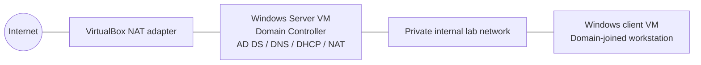

# Active Directory Home Lab with VirtualBox and PowerShell

A hands-on Windows administration lab that simulates a small business network using Oracle VirtualBox, Windows Server, Active Directory Domain Services (AD DS), DNS, DHCP, NAT/routing, and a Windows client joined to the domain.

> **Status:** Build in progress. Replace planned steps with your actual results as you complete the lab. Do not claim a feature is working until you have tested it.

## Objectives

- Build an isolated virtual lab with a domain controller and a Windows client.
- Install and configure AD DS and DNS.
- Configure DHCP and routing/NAT for the lab's private network, if following the full tutorial design.
- Create test users using PowerShell.
- Join the client to the domain and verify domain sign-in.
- Document configuration, test evidence, errors, and fixes.

## Lab topology

The domain controller has two virtual network adapters in the tutorial design: one for outbound connectivity and one for the private lab network. Keep the lab separate from any work or production network.

## Planned components

| Component | Planned role |
|---|---|
| Oracle VirtualBox | Runs the virtual machines |
| Windows Server 2019 or a currently supported evaluation version | Domain controller |
| Windows Pro client evaluation/install media | Domain-joined client |
| Active Directory Domain Services | Central directory and domain authentication |
| DNS | Resolves the lab domain and host names |
| DHCP | Assigns client IP settings on the private lab network |
| PowerShell | Creates and verifies lab user accounts |

**Version note:** The referenced tutorial was published in 2021 and uses Windows Server 2019 and Windows 10. Those versions are now old. You may use them to reproduce the tutorial, but check Microsoft's current lifecycle and evaluation-download pages before choosing installation media. Use evaluation media and licensing in accordance with Microsoft's terms.

## Prerequisites

- A computer capable of running two VMs. The required memory depends on the host OS and VM allocations; leave enough RAM for your host to remain responsive.
- Virtualization enabled in BIOS/UEFI.
- Oracle VirtualBox installed.
- Official Windows installation/evaluation ISOs.
- Enough free disk space for both virtual disks.
- Administrator access on your own computer.

## Build checklist

- [ ] Install VirtualBox and obtain official installation media.
- [ ] Create the domain-controller VM.
- [ ] Install Windows Server and configure the VM guest tools.
- [ ] Configure and label the two network adapters.
- [ ] Assign a static IP to the private-facing server adapter.
- [ ] Install AD DS and promote the server to a domain controller.
- [ ] Verify DNS and domain health.
- [ ] Configure DHCP and NAT/routing if using the tutorial's full topology.
- [ ] Create test users with PowerShell.
- [ ] Create a Windows client VM on the private lab network.
- [ ] Verify DHCP address, gateway, DNS, and connectivity.
- [ ] Join the client to the domain.
- [ ] Sign in with a lab domain account and verify the identity.
- [ ] Capture screenshots and record actual results.
- [ ] Review the repository for passwords, personal data, and secrets before publishing.

## Repository map

- `docs/SETUP.md` — implementation checklist and setup notes.
- `docs/TESTING.md` — verification plan and evidence checklist.
- `docs/TROUBLESHOOTING.md` — common issues to investigate.
- `docs/DECISIONS.md` — design choices and their reasons.
- `scripts/New-LabUsers.ps1` — creates clearly named test users in a selected OU.
- `scripts/Test-LabDomain.ps1` — basic domain-controller checks.
- `configs/` — safe example configuration notes only.
- `screenshots/` — add your own screenshots after running the lab.

## Security and privacy

- This is a **disposable learning lab**, not a production design.
- Never reuse a real password. The user-creation script prompts for a password rather than embedding one.
- Do not expose the domain controller's management ports to the public internet.
- Do not bridge the lab onto a work or production network.
- Do not commit secrets, real customer data, account details, or unredacted host/network information.
- Use a private GitHub repository until you've reviewed screenshots and files for sensitive information.

## Reference

Original tutorial: [Josh Madakor — How to Setup a Basic Home Lab Running Active Directory (Oracle VirtualBox) | Add Users w/PowerShell](https://www.youtube.com/watch?v=MHsI8hJmggI)

This repository is an original learning companion and implementation record, not a copy of the video's transcript or code. Update it with your own configuration, tests, screenshots, and lessons learned.
