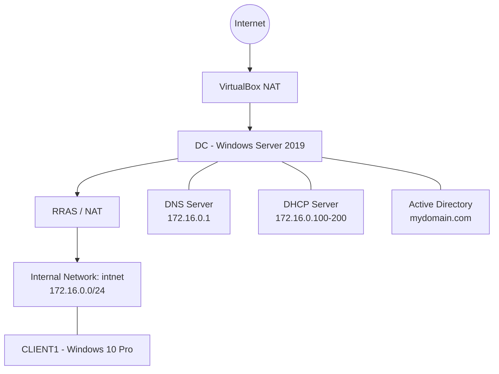

# Active Directory Home Lab: Technical Walkthrough

## 1. Introduction

This document explains the architecture, configuration, implementation and learning outcomes of the Active Directory home lab.

The project recreates a small business Windows network using Oracle VirtualBox, Windows Server 2019, Active Directory Domain Services, DNS, DHCP, Routing and Remote Access (RRAS), and a Windows 10 Pro workstation.

The lab was built by following Josh Madakor's Active Directory home lab tutorial.

### Project Objectives

The main objectives were to:

- Build an isolated virtual network.
- Install and configure a Windows Server domain controller.
- Create an Active Directory forest and domain.
- Configure DNS and DHCP.
- Configure routing and Network Address Translation (NAT).
- Create organizational units and administrative accounts.
- Generate employee accounts using PowerShell.
- Join a Windows client to the domain.
- Verify network connectivity and domain authentication.

---

## 2. Understanding the Lab Architecture

The lab uses two virtual machines connected through an isolated internal network.

### Virtual Machines

| Virtual Machine | Operating System | Purpose |
|---|---|---|
| DC | Windows Server 2019 Standard Evaluation | Domain Controller and network services |
| CLIENT1 | Windows 10 Pro | Domain-joined client workstation |

### Network Configuration

The domain controller uses two network adapters.

| Interface | Network Type | IP Address | Purpose |
|---|---|---|---|
| INTERNET | VirtualBox NAT | 10.0.2.15 | Outbound connectivity |
| INTERNAL | VirtualBox Internal Network | 172.16.0.1 | Private lab network |

The private network uses:

- Network: 172.16.0.0/24
- Subnet Mask: 255.255.255.0
- Internal Network Name: intnet
- Domain Controller Internal IP: 172.16.0.1

The internal network is separate from the host computer's physical network.

### Network Topology



The domain controller provides directory services and network services to CLIENT1.

---

## 3. Understanding the Core Technologies

### 3.1 Active Directory Domain Services

Active Directory Domain Services (AD DS) is Microsoft's directory service for managing users, computers, groups and other network resources.

Instead of managing every workstation and user account independently, administrators can centrally manage identities and access through a domain.

For this lab, a new Active Directory forest was created.

| Setting | Configuration |
|---|---|
| Domain Name | mydomain.com |
| NetBIOS Name | MYDOMAIN |
| Domain Controller | DC |
| Forest Functional Level | Windows Server 2016 |
| Domain Functional Level | Windows Server 2016 |

The domain controller is responsible for authenticating domain users and managing directory objects.

### 3.2 Organizational Units

Organizational Units (OUs) provide a way to organize objects within Active Directory.

Two OUs were created:

| OU | Purpose |
|---|---|
| _ADMINS | Dedicated administrative accounts |
| _USERS | Generated employee accounts |

A separate administrative account was created in the `_ADMINS` OU and added to the Domain Admins security group.

The `_USERS` OU contains the generated employee accounts.

### 3.3 DNS

Domain Name System (DNS) translates domain and host names into IP addresses.

Active Directory relies heavily on DNS because domain clients use DNS records to locate domain controllers and related services.

In this lab:

- The domain controller uses 127.0.0.1 as its preferred DNS address.
- Client devices use 172.16.0.1 as their DNS server.
- The Active Directory domain is mydomain.com.

CLIENT1 successfully resolved and communicated with mydomain.com during testing.

### 3.4 DHCP

Dynamic Host Configuration Protocol (DHCP) automatically assigns network configuration to client devices.

Rather than manually configuring an IP address on every workstation, a DHCP server provides the required settings.

The DHCP scope was configured as follows:

| Setting | Value |
|---|---|
| Network | 172.16.0.0/24 |
| Starting Address | 172.16.0.100 |
| Ending Address | 172.16.0.200 |
| Subnet Mask | 255.255.255.0 |
| Default Gateway | 172.16.0.1 |
| DNS Server | 172.16.0.1 |
| DNS Domain | mydomain.com |
| Lease Duration | 8 days |

CLIENT1 successfully received its IP configuration from this scope.

### 3.5 Routing and Network Address Translation

Routing and Remote Access (RRAS) was installed and configured on the domain controller.

Network Address Translation (NAT) allows devices on the private internal network to access external networks through the domain controller's outbound interface.

The configuration uses:

- Public-facing interface: INTERNET
- Private-facing interface: INTERNAL
- NAT public address: 10.0.2.15
- Internal gateway address: 172.16.0.1

CLIENT1 uses 172.16.0.1 as its default gateway.

The successful internet connectivity test from CLIENT1 confirmed that the configured outbound path was working.

---

## 4. Implementation Walkthrough

### Stage 1: Build the Domain Controller

A Windows Server 2019 Standard Evaluation virtual machine was created in Oracle VirtualBox.

| Setting | Value |
|---|---|
| VM Name | DC |
| Memory | 2 GB |
| Processors | 4 |
| Virtual Disk | 40 GB |
| Installation Type | Desktop Experience |
| Guest Additions | Installed |

The server was renamed to DC and configured with two network adapters.

The INTERNAL adapter received a static IP address of 172.16.0.1/24.

### Stage 2: Install Active Directory

The Active Directory Domain Services role was installed through Server Manager.

The server was promoted to a domain controller, creating a new forest named mydomain.com.

DNS was installed as part of the domain controller configuration.

After the restart, domain information and forest information were checked using PowerShell:

```powershell
Get-ADDomain
Get-ADForest
```

Both commands successfully returned the expected domain information.

### Stage 3: Create Administrative Organization and Account

The `_ADMINS` organizational unit was created in Active Directory Users and Computers.

A separate domain administrator account was created and added to the Domain Admins group.

The account was used to verify administrative login and group membership.

### Stage 4: Configure RRAS and NAT

The Remote Access role was installed with Routing enabled.

RRAS was configured to use the INTERNET adapter as the public interface for NAT.

The INTERNAL adapter remained connected to the isolated lab network.

RRAS was confirmed to be running, and NAT appeared under the IPv4 configuration.

### Stage 5: Configure DHCP

The DHCP Server role was installed on DC and authorized in Active Directory.

A new scope was created for the internal subnet.

The scope was activated and configured to provide:

- IP addresses from 172.16.0.100 to 172.16.0.200.
- Default gateway 172.16.0.1.
- DNS server 172.16.0.1.
- DNS domain mydomain.com.

The DHCP scope, options and interface bindings were subsequently verified.

### Stage 6: Disable IE Enhanced Security Configuration

Internet Explorer Enhanced Security Configuration was disabled for both Administrators and Users.

This was done as a lab convenience while following the tutorial.

This setting reduces browser security protections and should not be treated as a recommended production configuration.

### Stage 7: Generate Employee Accounts with PowerShell

The tutorial's `1_CREATE_USERS.ps1` script was used to generate employee accounts.

The accompanying `names.txt` file was modified to include an additional name.

The final names file contained 1,002 entries.

A total of 1,000 accounts were created in the `_USERS` OU.

Two generated usernames appeared twice:

- smolder
- trollins

These duplicates explain why 1,002 entries resulted in 1,000 unique accounts.

The account count was checked using:

```powershell
Get-ADUser -SearchBase "OU=_USERS,DC=mydomain,DC=com" -Filter * |
Measure-Object
```

The result confirmed 1,000 accounts.

Sample accounts were also checked to verify that they were enabled.

### Stage 8: Create the Windows Client

A Windows 10 Pro virtual machine named CLIENT1 was created.

The client was configured with:

- 4 GB RAM.
- 4 processors.
- Internal Network attachment.
- Internal Network name `intnet`.
- Bidirectional Shared Clipboard.
- Bidirectional Drag and Drop.

Windows 10 Pro was installed using an ISO created with Microsoft's Media Creation Tool.

A temporary local Windows account was created during the initial Windows setup.

### Stage 9: Verify Client Network Connectivity

CLIENT1 was connected to the internal network and received its IP configuration from the DHCP server.

The following command was used:

```cmd
ipconfig
```

The client received:

- An IP address within the configured DHCP scope.
- Subnet mask 255.255.255.0.
- Default gateway 172.16.0.1.

Internet connectivity was tested:

```cmd
ping google.com
```

Domain connectivity was tested:

```cmd
ping mydomain.com
```

Both tests completed successfully.

### Stage 10: Join CLIENT1 to Active Directory

The client computer was renamed CLIENT1 and joined to the mydomain.com domain.

An authorized domain administrator account was used during the domain join.

After restarting, the client was accessed using domain credentials.

The following command verified the logged-in identity:

```cmd
whoami
```

The computer's domain membership was also verified:

```cmd
systeminfo | findstr /B /C:"Domain"
```

### Stage 11: Verify Employee Authentication

A generated employee account was used to sign in to CLIENT1.

The Windows user profile loaded successfully.

The `whoami` command confirmed that the account authenticated using the MYDOMAIN domain.

This demonstrated that generated employee accounts could authenticate on a separate domain-joined workstation.

---

## 5. What Was Learned

### Windows Server Administration

- Installing Windows Server in a virtual machine.
- Installing server roles through Server Manager.
- Renaming and configuring a Windows Server machine.
- Promoting a server to a domain controller.
- Managing Windows Server through graphical tools and PowerShell.

### Active Directory Administration

- Understanding forests and domains.
- Creating and managing Organizational Units.
- Creating domain user accounts.
- Understanding administrative security groups.
- Understanding the relationship between user accounts and computer accounts.
- Joining Windows workstations to a domain.
- Verifying domain authentication.

### Networking Fundamentals

- Understanding NAT and Internal Network adapters in VirtualBox.
- Configuring static IPv4 addressing.
- Understanding subnet masks and private IP addressing.
- Understanding DHCP scopes and options.
- Configuring a default gateway.
- Understanding the role of DNS in Active Directory.
- Troubleshooting connectivity using ping and ipconfig.

### PowerShell

- Running PowerShell with administrative privileges.
- Using commands to query Active Directory.
- Reading user data from a text file.
- Using PowerShell to generate Active Directory accounts.
- Counting directory objects.
- Checking account properties and group membership.
- Identifying duplicate usernames with PowerShell.

### Testing and Documentation

- Verifying server and client configurations.
- Recording expected and observed results.
- Capturing screenshots as technical evidence.
- Documenting design decisions and troubleshooting steps.
- Maintaining a project repository using GitHub.

---

## 6. Troubleshooting and Lessons Learned

Several issues were encountered while following the tutorial.

The problems, investigation steps and resolutions are documented separately in:

[`TROUBLESHOOTING.md`](./TROUBLESHOOTING.md)

Important lessons from the implementation included:

- Choosing the correct PowerShell script from the tutorial repository.
- Understanding why duplicate generated usernames affect the final account count.
- Using Microsoft's Media Creation Tool when the direct Windows ISO download page redirected to the general download page.
- Completing Windows setup with a local account rather than a Microsoft account.

---

## 7. Project Limitations and Security Considerations

This is a disposable learning environment. It is not a production-ready Active Directory deployment.

### Shared Lab Password

The tutorial's user creation script used the same default lab password for generated accounts.

This is suitable only for a controlled, disposable exercise. It is not an acceptable password practice for production environments.

### IE Enhanced Security Configuration

IE Enhanced Security Configuration was disabled during the lab.

This reduces browser security protections and should not be copied into a production server configuration without an appropriate security review.

### Operating System Lifecycle

The Windows 10 Pro client was used to reproduce the tutorial.

Windows 10 Home and Pro reached end of support on October 14, 2025. This environment is therefore retained as a legacy tutorial lab rather than a recommended current desktop deployment.

Windows Server 2019 remains in extended support until January 2029.

### Network Isolation

The lab uses a VirtualBox Internal Network for the private client network.

It should remain isolated from work, customer and production networks.

---

## 8. Project Documentation

| Document | Purpose |
|---|---|
| `SETUP.md` | Detailed configuration and installation record |
| `TESTING.md` | Commands, checks and observed results |
| `TROUBLESHOOTING.md` | Problems encountered and their resolutions |
| `DECISIONS.md` | Design decisions and reasoning |
| `LAB-WALKTHROUGH.md` | Technical explanation and learning outcomes |

Screenshots and evidence are maintained in the repository's `screenshots/` directory.

---

## 9. Conclusion

The lab successfully demonstrates the creation of a basic Windows Active Directory environment.

The domain controller provides centralized directory services, DNS, DHCP and NAT for an isolated virtual network.

A Windows 10 Pro workstation successfully obtained an IP address, communicated through the domain controller, joined the Active Directory domain and authenticated using a generated employee account.

The project provided practical exposure to Windows Server administration, Active Directory, DNS, DHCP, routing, PowerShell, domain authentication and basic network troubleshooting.